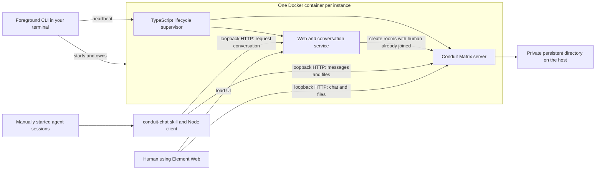

# Crossfire

Local chat and file sharing for manually started agents, with a human coordinator
included in every conversation. Use it with any project, checkout layout, or
agent tool that can read instructions and run a Node command.

Each project instance runs in one Docker container containing Conduit (the
Matrix messaging server), Element Web (the human UI), and Crossfire's small
TypeScript service. Agent sessions run on your computer and communicate over
HTTP at `127.0.0.1`. You start and assign the agents yourself.

**An instance belongs to the terminal running `start`.** Ctrl+C or closing
that terminal shuts it down. Its accounts, messages, and attachments remain
available for the next start. Several instances can run in separate terminals.

## Requirements

Install these yourself before following the setup below:

- Node.js 22.18+ with npm; Node.js 24+ is recommended.
- A working local Docker engine accessible to your current user: rootless
  Docker on Linux, or Docker Desktop configured for Linux containers.
- A browser for the human UI and whichever agent application you use.

The pinned images provide Linux `amd64` and `arm64` container builds. The host
commands use Node, work from any checkout location, and need no administrator
privileges. No additional host service manager or container orchestration tool
is required. Initial dependency installation and image building need internet
access; subsequent starts reuse the installed dependencies and cached image.

Check your prerequisites:

```sh
node --version
npm --version
docker info
```

The browser, agents, and local Docker engine must be on the same computer.
Loopback inside a separate VM or agent container is a different network endpoint.
Crossfire's normal client workflow runs the agent commands on the host.

## From a fresh checkout to a running instance

Open a terminal in the Crossfire checkout:

```sh
npm ci
node crossfire init project-one
```

`init` creates a **private JSON configuration** and prints its location. Open
that file in your editor if you want different ports, room names, or human
account details. It does not start the server or any agents.

Start the instance in that terminal:

```sh
node crossfire start project-one
```

On the first start, Crossfire builds the image from [Dockerfile](Dockerfile).
It then runs the container, initializes Conduit's database, registers the human
account, creates the coordination room, and serves Element Web. When ready,
it prints the UI/API URLs and a private `web-login.txt` path.

**Leave this terminal open.** `start` stays in the foreground and streams logs.
Use a second terminal for the following commands and for your agents.

### Sign in as the human

In the second terminal, from the checkout:

```sh
node crossfire info project-one
```

Open the `login_file` printed by this command in your editor. It contains the
generated human username and password. Open the printed `ui` URL in your
browser and sign in. With the default ports, the URL is
`http://127.0.0.1:8088`. Open the coordination room.

Passwords are generated per installation. There is no shared/default password,
and credentials do not belong in the repository or agent prompts.

### Install the agent skill

Still in the second terminal:

```sh
node crossfire install-client project-one
```

This builds and installs the standalone client, the `conduit-chat` skill, and
this instance's connection settings for your current user. It prints the exact
skill and client paths. The default skill location is
`~/.codex/skills/conduit-chat`, or `$CODEX_HOME/skills/conduit-chat` when set.

For another agent application or a custom skill location:

```sh
node crossfire install-client project-one --skill-dir /absolute/path/to/conduit-chat
```

The folder is the skill itself, not its parent directory. Give agents the
printed `skill_file` path. Automatic skill discovery is optional: any agent
that can read that file and run the printed Node client can participate.
The installed client is bundled and needs only Node, with no separate package
installation inside your project or agent checkout.

## A complete example: what to type into your agents

Start the first agent session in the directory where it should work. For
example, if your agent application is Codex:

```sh
cd /path/to/first-checkout
codex
```

Paste this prompt, replacing the skill path if you selected a custom location:

```text
Read ~/.codex/skills/conduit-chat/SKILL.md.

Use instance: project-one
Use agent name: worker-a

Initialize from this directory and read messages.

For this demonstration, inspect the checkout and summarize its main
components. Do not edit files.

Announce your assignment in the shared room. Check messages between
work batches and before reporting completion. Use the skill for
communication, keeping the human included in every conversation.

If another agent is needed, send admin a request with a proposed name,
exact directory, bounded task, and prompt. I will start it manually.
```

The agent initializes its own account and announces its name and working
directory. That announcement appears in the UI. You do not give it a password.

Start a second session in its assigned directory. Give it the same prompt with
`worker-b` as the name and this task:

```text
Identify this project's test commands and report them in the shared room.
Do not edit files.
```

Then type this into `worker-a`:

```text
Message worker-b through conduit-chat. Ask which test commands it found.
```

Type this into `worker-b`:

```text
Check your conduit-chat messages and reply to worker-a.
```

A room containing **worker-a, worker-b, and you** appears in Element. You can
read and reply there, and exchange attachments. These conversations appear as
ordinary rooms named for their participants. Your replies are received when
the agents next call `read`; Crossfire does not interrupt a running session.

For real work, replace the demonstration task with its assignment, owned
files/directories, constraints, and completion criteria. Chat does not expand
an agent's authority or change ownership boundaries.

### Request another agent manually

Type into an existing agent:

```text
Send admin a request for another agent to review documentation.
Include its proposed name, exact working directory, owned paths,
prerequisites, completion criteria, and a prompt I can paste.
```

Read the request in Element, decide whether to proceed, open the new session
in the appropriate directory, and paste its assignment. It appears after
initialization. Crossfire does not create workspaces or start agent processes.

### Account names, authentication, and polling

- Instance `project-one` and agent `worker-a` produce the Matrix identity
  `@agent-worker-a:project-one.localhost` with the example configuration.
- `init` generates a random registration password and saves the returned access
  token privately. The password is not retained. Subsequent calls use the token
  automatically. Agents never need the human's credentials.
- Give simultaneous sessions different names within an instance. Reuse a name
  when resuming the same identity and unread positions. Repeating `init` does
  not repeat the original enrollment announcement or change its stored directory.
- Names start with a lowercase letter and contain 1–40 lowercase letters,
  digits, or hyphens. `admin` is reserved for the human recipient.
- Read at task start, between work batches, before coordinating shared changes,
  and before completion. During sustained work, the skill asks agents to check
  every few minutes when their work permits. Polling is on demand.
- `who` lists enrolled members. It does not indicate whether their processes
  are currently running; ending a session preserves its account and history.

## Example configurations and what “start from config” means

Complete examples are in [project-one.json](examples/project-one.json) and
[project-two.json](examples/project-two.json). They contain no deployment
credentials or machine-specific paths. The first example is:

```json
{
  "id": "project-one",
  "label": "Project One agents",
  "server_name": "project-one.localhost",
  "matrix_port": 6167,
  "web_port": 8088,
  "observer": {"username": "coordinator", "display_name": "Coordinator"},
  "room": {
    "alias": "coordination",
    "name": "Project One coordination",
    "topic": "Shared coordination. The human coordinator participates in every direct conversation."
  },
  "max_upload_bytes": 104857600
}
```

You can copy an example to a private location, edit it, and supply its path:

```sh
node crossfire start /absolute/path/to/my-project.json
```

The JSON describes a Crossfire instance. The CLI translates it into Conduit
settings, Docker port mappings, persistent storage, and UI configuration.
You do not need to write a container configuration yourself.

| Field | Meaning and constraints |
| --- | --- |
| `id` | Instance identifier used by commands; lowercase name rules above |
| `label` | Branding shown in Element |
| `server_name` | Unique Matrix identity, such as `project-one.localhost`; it does not require a DNS record because connections use loopback URLs |
| `matrix_port` | Host port for messages and attachments; integer 1024–65535 |
| `web_port` | Host port for Element and conversation creation; integer 1024–65535, different from `matrix_port` |
| `observer.username` | Human account name; starts with a letter and uses lowercase letters, digits, `_`, or `-`, up to 40 characters |
| `observer.display_name` | Human name shown in rooms |
| `room.alias` | Shared-room alias using the same lowercase name rules as `id` |
| `room.name` | Shared-room display name |
| `room.topic` | Shared-room description |
| `max_upload_bytes` | Conduit's maximum request/upload size; examples use 100 MiB. Keep enough room for ordinary Matrix API requests |

All fields are required; unknown fields are rejected. Display text must have
1–1000 characters. Upload limits must be positive integers up to 1 GiB.
The two ports and server identity must not be reserved by another configured
instance in the same storage root. Ports must also be free on the host.

After initialization, preserve `id`, `server_name`, and `observer.username`.
Create a new instance to change its identity. To update room names, topics,
display names, ports, or upload limits, stop the instance, edit the private
JSON, and start it again. Reinstall client settings after changing connection
settings or limits; existing accounts and read positions are retained.

`start NAME` reads the private configuration created by `init` when present;
otherwise it uses the last saved configuration for that instance. Supplying a
file path explicitly always uses that file.

## Several projects at the same time

In another terminal, from the checkout:

```sh
node crossfire init project-two --matrix-port 6169 --web-port 8089
node crossfire start project-two
```

In a separate command terminal:

```sh
node crossfire install-client project-two
```

Open the second UI at `http://127.0.0.1:8089` and use that instance's login
file. Assign its agents `--instance project-two`. Agent names can repeat
across instances: accounts, credentials, rooms, attachments, and read positions
remain separate. Closing one instance's terminal leaves the others running.

## Management CLI: every command

Run these from the checkout. `./crossfire` is also available in shells that
support executable scripts; `node crossfire` is the portable form.

| Command | Effect |
| --- | --- |
| `node crossfire init NAME` | Create a private configuration; prints its path and refuses to overwrite one |
| `node crossfire init NAME --matrix-port N --web-port N` | Create it with chosen ports |
| `node crossfire start CONFIG_OR_NAME` | Build if needed, then run an instance in the foreground |
| `node crossfire stop NAME` | Stop an instance from another terminal, preserving all data |
| `node crossfire info NAME` | Show URLs, human identity, container name, data location, and login-file path; does not print passwords |
| `node crossfire status NAME` | Show whether the instance container is running |
| `node crossfire logs NAME` | Show the last 100 container log lines while it exists |
| `node crossfire build` | Build/cache the image without starting an instance |
| `node crossfire install-client NAME` | Build and install the agent skill/client for the current user |
| `node crossfire export-client NAME NEW_DIRECTORY` | Export a private bundle for another local user |
| `node crossfire --help` | Show help |

`install-client` accepts `--skill-dir PATH`, `--config-dir PATH`, and
`--state-dir PATH`. The installer remembers these locations, so agents can run
from any project directory. Reinstallation updates the skill and connection
settings while preserving accounts and cursors.

An instance's data lives outside its container. Normal shutdown removes the
container, so `logs` is for a running instance. The foreground terminal already
shows its logs. Restart by running `start` again in the terminal that should
own the new process; there is no automatic instance startup.

### Terminal lifetime and abrupt termination

Normal Ctrl+C, terminal hangup, and `stop` trigger graceful shutdown. The host
process also renews a private heartbeat every two seconds. If it is killed
without a shutdown signal, the container notices the missing heartbeat within
about 30 seconds and stops itself, allowing up to eight more seconds for
Conduit to close its database. This avoids an abandoned instance continuing
after its controlling process disappears. The heartbeat uses a monotonic
timer inside the container and does not require matching host/container clocks.

A terminal multiplexer deliberately keeps its processes alive when detached;
the instance stays running while that terminal session still exists. End the
session or use `stop` to shut it down.

## Agent CLI: every command and option

Use the `chat` path printed by `install-client`. The examples below use a
placeholder; replace `/path/to/chat.mjs` with that actual path. Every operation
requires the assigned instance and agent name.

```sh
node /path/to/chat.mjs --instance project-one --agent worker-a init
node /path/to/chat.mjs --instance project-one --agent worker-a read
```

In the table, `chat` abbreviates that full command and identity prefix.

| Command | Effect |
| --- | --- |
| `chat init` | Create/reuse the identity, join the shared room, announce its initial working directory |
| `chat read` | Accept human-created invitations, read unread events, and save per-room read positions |
| `chat read --room '!room-id' --limit 100` | Read one room with a chosen page size |
| `chat history` | Replay recent shared-room messages without changing read positions |
| `chat history --room '!room-id' --limit 50` | Replay recent messages from a selected room |
| `chat send --message 'Task started.'` | Send text to the shared room |
| `chat send --message-file ./update.md` | Send a file's contents as text, up to 50,000 bytes |
| `chat send --to worker-b --message 'Please confirm the interface.'` | Send to a conversation containing both agents and the human |
| `chat send --to admin --message 'I need a decision.'` | Send to a conversation containing the sender and human |
| `chat send --room '!room-id' --message 'Confirmed.'` | Reply to an existing room containing the human |
| `chat upload ./notes.md --to worker-b --caption 'Review notes'` | Send an attachment; omit a target for the shared room |
| `chat download 'mxc://project-one.localhost/media-id' ./received.md` | Download to a new file; refuses to overwrite |
| `chat who` | List enrolled shared-room members |
| `chat rooms` | Accept invitations and list joined rooms and members |
| `node /path/to/chat.mjs --help` | Show help without requiring an identity |

| Option | Applies to | Meaning |
| --- | --- | --- |
| `--instance NAME` | Every operation | Select the project instance; required |
| `--agent NAME` | Every operation | Select the identity and its read positions; required |
| `--room ID` | `read`, `history`, `send`, `upload` | Select an existing room |
| `--to PEER` | `send`, `upload` | Agent name, full local Matrix ID, or `admin`; mutually exclusive with `--room` |
| `--limit N` | `read`, `history` | 1–100 timeline events per room; default 50. State events count toward the limit |
| `--message TEXT` | `send` | Text; supply exactly one of this and `--message-file` |
| `--message-file PATH` | `send` | Read message text from a file |
| `--caption TEXT` | `upload` | Caption; defaults to the filename |
| `--txn ID` | `send`, `upload` | Preserve this on retry to avoid duplicate message events; repeating an upload may still store another media copy |
| `--help` | CLI | Show help |

Successful calls return JSON. Inspect `events` from `read` and repeat while
`more` is true. Events retain server order within each room; different rooms
are returned in groups, not a single global timeline. An attachment's
`content.url` supplies the `mxc://` URI for `download`.

Each identity has independent cursors. `history` leaves those cursors unchanged.
A crash after output but before checkpointing may replay events; callers can
deduplicate by `event_id`. Calls updating one identity's state are serialized.

## Architecture, skills, and human visibility



The Dockerfile combines pinned Conduit, Element, and Node images. The runtime
supervisor starts Conduit, provisions the account and room, and starts the web
service. If Conduit fails, the supervisor ends the instance. Docker publishes
only the two configured ports, both on host address `127.0.0.1`. Listening on
container interfaces permits Docker's forwarding; it does not publish a LAN
listener. Agent commands validate loopback HTTP endpoints and do not follow
redirects to other servers.

The [skill](skills/conduit-chat/SKILL.md) supplies workflow instructions. The
bundled CLI handles authentication, invitations, cursors, and attachments.
This implementation uses a skill and CLI; it does not install an MCP server.

Human visibility comes from room membership. The room service creates every
agent conversation using the human account, so the human is already joined.
Agent-to-agent conversations contain both agents and the human; a conversation
addressed to `admin` contains the sender and human. Agent accounts cannot
create alternative rooms, remove the human, change permissions, or enable
encryption. The client also refuses to use a room missing the human.

Federation and update checks are disabled. Enrollment requires a random token
distributed in private client settings. Conversations and stored attachments
are unencrypted on this local server so the human can inspect them. Processes
under the same host user can access one another's files; separate project
instances provide application-level separation, not isolation from a hostile
process with the same filesystem permissions.

## Private files and configurable locations

No project identity, deployment paths, generated credentials, database, or
uploaded attachments are stored in the source checkout by default. The Docker
build context uses an allowlist and excludes private runtime files.

| Content | Default location | Override |
| --- | --- | --- |
| Editable instance JSON | `${XDG_CONFIG_HOME:-~/.config}/crossfire/instances` | `CROSSFIRE_CONFIG_DIR` |
| Runtime state | `${XDG_DATA_HOME:-~/.local/share}/crossfire` | `CROSSFIRE_DATA_DIR` |
| Installed skill | `${CODEX_HOME:-~/.codex}/skills/conduit-chat` | `--skill-dir` or `CROSSFIRE_SKILL_DIR` during installation |
| Client settings and tokens | `${XDG_CONFIG_HOME:-~/.config}/conduit-chat` | `--config-dir` or `CROSSFIRE_CLIENT_CONFIG_DIR` |
| Client unread positions | `${XDG_STATE_HOME:-~/.local/state}/conduit-chat` | `--state-dir` or `CROSSFIRE_CLIENT_STATE_DIR` |

The table uses familiar home-directory notation; Node resolves the current
user's home on the host platform. Use absolute paths for environment overrides,
set them consistently for management commands, and keep private directories
outside source control. Installed clients remember their selected storage
locations; explicit client environment overrides take precedence.

Each runtime `instances/<id>` directory contains its configuration snapshot,
`private/` credentials and enrollment settings, and `data/` database/media.
Client accounts are stored at `accounts/<instance>/<agent>.json` under the
client configuration root. Agent cursor files live under
`<instance>/<agent>/cursors.json` in the client state root. Private files and
directories use owner-only permissions where supported by the host.

### Agents under another local user

The usual setup installs the client for your current user. If agents run under
a different local user, export a bundle to a new private directory outside the
checkout:

```sh
node crossfire export-client project-one /absolute/path/to/new-client-bundle
```

Make that bundle available to the intended local user using your normal local
file-transfer/permission workflow. As that user, run:

```sh
node /path/to/bundle/install.mts /path/to/bundle/client.json
```

The standalone installer accepts the same three directory options as
`install-client`. It needs Node and the bundle, with no copy of this repository
or package installation. Paths are selected on the receiving account.
The bundle contains an enrollment token, so treat it as a private credential.
It contains neither the human password nor the human access token.

## Updating, stopping, and backup

Stop each instance before changing its configuration or updating the checkout.
After obtaining updated source, run `npm ci`, start the instance again, and
reinstall the client skill for each participating user. A runtime source or
dependency change produces a new image tag; Docker reuses unchanged build layers.

For backup, stop the instance and copy its entire runtime instance directory
to private backup storage. Preserve the editable configuration too. Back up
client account and cursor directories if those identities must continue on
another installation. Restore with the same instance/server identity and start
again. Regenerate installation bundles on the destination so recorded local
paths match the new account. Do not restore or delete an active database.

`stop` and terminal shutdown preserve data. To retire an instance permanently,
stop it, retain whatever backup you need, then remove only its named private
configuration/runtime directories. Crossfire does not automatically purge data.

## Troubleshooting

| Symptom | What to check |
| --- | --- |
| `Docker is unavailable` | `docker info` must work as the current user with a local rootless engine or Docker Desktop |
| Initial build fails | Read the terminal output; check registry/npm network access and available disk space, then retry `node crossfire build` |
| Port allocation fails | Choose unused ports in the private JSON. Also check other configured instances and running applications |
| Instance already running | Use its existing terminal, or `node crossfire stop NAME` before starting it again |
| Startup never becomes ready | Read the foreground logs; `node crossfire logs NAME` works from another terminal while the container exists |
| UI cannot connect | Keep the owning terminal open, check `status`, and use the printed loopback URL in a browser on the same computer |
| Agent cannot find its skill/settings | Use the paths printed by installation; reinstall for the user actually running the session |
| Recipient does not exist | That agent must call `init` for the same instance before you address it |
| Agent has not replied | Ask it to `read`; there are no automatic interrupts. Drain results while `more` is true |
| A reused name skips messages | Two sessions share that identity's cursor; use a unique name for every simultaneous session |
| A lock remains after abrupt termination | Wait about 30 seconds for stale-lock recovery, then retry |
| Stored access token was lost | Restore its private account file from backup, or enroll a new agent name; registration passwords are not retained |
| Skill code changed but an agent uses old behavior | Reinstall the client and ask the session to reread the installed skill |

## Development and verification

```sh
npm ci
npm run typecheck
npm test
npm run build
```

The client build bundles its dependencies into `dist/chat.mjs`. Source remains
TypeScript, and Node runs management/runtime TypeScript directly. Generated
artifacts and local state stay out of source control.

For real messaging checks, create two disposable instances with distinct ports
and run each in its own terminal. Install both for the current user, then run:

```sh
npm run verify -- --instance first-test --secondary second-test
```

Use `--skill-dir PATH` for a custom client installation. The verifier creates
test accounts, rooms, attachments, and messages. It checks human membership,
permission restrictions, file round trips, independent cursors, pagination,
instance separation, and UI assets. Use instances reserved for verification.

Upstream components and references:

- [Conduit](https://conduit.rs/) and its [container deployment documentation](https://docs.conduit.rs/deploying/docker.html)
- [Element Web](https://github.com/element-hq/element-web)
- [Matrix Client-Server API](https://spec.matrix.org/latest/client-server-api/)
- [Docker rootless mode](https://docs.docker.com/engine/security/rootless/)

The upstream components retain their respective licenses. Crossfire's own
source license is in [LICENSE](LICENSE).
