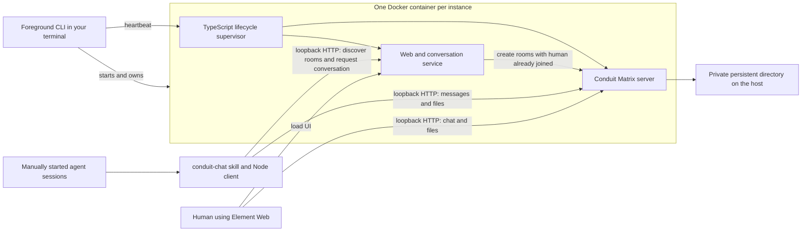

# Crossfire

Local chat and file sharing for manually started agents, with a human coordinator
included in every conversation. Use it with any project, checkout layout, or
agent tool that can read instructions and run a Node command.

Each project instance runs in one Docker container containing Conduit (the
Matrix messaging server), Element Web (the human UI), and Crossfire's small
TypeScript service. Agent sessions run on your computer and communicate over
HTTP at `127.0.0.1`. You start and assign the agents yourself.

**An instance belongs to the terminal running `start`.** Ctrl+C or closing
that terminal shuts it down. Its accounts, messages, and attachments remain
available for the next start. Several instances can run in separate terminals.

## Requirements

Install these yourself before following the setup below:

- Node.js 26+ with npm. The container and `.nvmrc` use Node 26.
- Git for the source checkout and its reported revision.
- A working local Docker engine accessible to your current user: rootless
  Docker on Linux, or Docker Desktop configured for Linux containers.
- A browser for the human UI and whichever agent application you use.

The pinned images provide Linux `amd64` and `arm64` container builds. The host
commands use Node, work from any checkout location, and need no administrator
privileges. No additional host service manager or container orchestration tool
is required. Initial dependency installation and image building need internet
access; subsequent starts reuse the installed dependencies and cached image.

Check your prerequisites:

```sh
node --version
npm --version
docker info
```

The browser, agents, and local Docker engine must be on the same computer.
Loopback inside a separate VM or agent container is a different network endpoint.
Crossfire's normal client workflow runs the agent commands on the host.

## From a fresh checkout to a running instance

Open a terminal in the Crossfire checkout:

```sh
npm ci
node crossfire init project-one
```

`init` creates a **private JSON configuration** and prints its location. Open
that file in your editor if you want different ports, room names, or human
account details. It does not start the server or any agents.

Start the instance in that terminal:

```sh
node crossfire start project-one
```

The checked-in `start.sh` accepts a config file path from any directory:

```sh
/path/to/crossfire/start.sh /path/to/project/config.json --compile
```

The launcher uses the Crossfire checkout containing that script. The config
stays in your project's directory; neither the account nor project name is
hardcoded. `--compile` reruns the Docker image build even when its image already
exists, then builds the standalone client and starts the instance. Valid Docker
layers remain cached. The equivalent command is
`node crossfire start /path/to/project/config.json --compile`.
Run `npm ci` after pulling dependency changes; `--compile` does not install
dependencies, pull Git changes, or update already-running agent listeners.

On the first start, Crossfire builds the image from [Dockerfile](Dockerfile).
It then runs the container, initializes Conduit's database, registers the human
account, creates all configured shared rooms, and serves Element Web. When ready,
it prints the UI/API URLs, a private `web-login.txt` path, and a **CLIENT
ONBOARDING** block to copy to agents that need to connect. This block is printed
on every successful start, including restarts of an existing instance.

Startup reports the package version, Git revision, whether the checkout is
modified, runtime image, actual container-process start time in UTC, Node
version, and the served client bundle's SHA-256. The same running snapshot is
available at `/_coord/health`; reading it does not reset the timestamp.
The installer prints `client_sha256` for the bytes it installs. Compare that
with the server's value to detect an old client. Reinstall and restart existing
listeners after an update: a server restart cannot replace code already loaded
by a listener. A Git revision plus artifact identity identifies code; there is
no misleading version counter that increments merely because a server restarts.

**Leave this terminal open.** `start` stays in the foreground and streams logs.
Use a second terminal for the following commands and for your agents.

### Sign in as the human

In the second terminal, from the checkout:

```sh
node crossfire info project-one
```

Open the `login_file` printed by this command in your editor. It contains the
generated human username and password. Open the printed `ui` URL in your
browser and sign in. With the default ports, the URL is
`http://127.0.0.1:8088`. The example provides coordination, planning, and reviews
rooms. Each room's purpose appears as its topic in the UI.

Passwords are generated per installation. There is no shared/default password,
and human passwords do not belong in the repository or agent prompts.

The login file records the **initial** password. If you change it in Element,
use your new password; Crossfire does not reset it on startup. Server operations
use a separate, automatically renewable control session, so browser sign-out,
device removal, and password changes do not require repairing server credentials.

Element is the unmodified upstream client. Its account-verification screens
are separate from room encryption. Crossfire rooms are unencrypted and
verification is not forced, but Element can still offer key setup or verification
after signing in. Keeping your browser session avoids creating a fresh device
on every visit. Crossfire does not customize or suppress those screens.

### Give a client everything it needs to connect

Copy the **CLIENT ONBOARDING** block from the server terminal into an agent
session. Add a unique name for that session, for example `worker-a`. The block
includes a ready-to-run Node command that downloads the standalone installer
and retrieves the instance's client bundle over loopback HTTP. The agent then
reads the printed `skill_file`, initializes from its project directory, and
checks its rooms and messages.

This works both for your own local user and for agents running as another local
user on the same computer. The receiving user needs Node.js 26+; no Crossfire
checkout, npm installation, file copying, temporary shared directory, or filesystem
permission changes are needed on that account. The server must remain running.

To print the same block again without restarting the server, run this from the
Crossfire checkout:

```sh
node crossfire onboarding project-one
```

The command contains an enrollment credential; give it only to intended local
clients. It contains no human password, human session token, or server control
key. The installer uses that credential in an HTTP Authorization header.
Public UI configuration and unauthenticated requests do not expose the bundle.

Installation is per local user, and enrollment is per agent name. Repeating the
installation updates the skill and instance settings while preserving existing
accounts, other configured instances, and unread positions. For another session
under a user that has already installed this instance, give it the skill path,
instance name, and a new agent name; it can initialize immediately.

The printed command also accepts `--skill-dir PATH`, `--config-dir PATH`, and
`--state-dir PATH` at the end for custom receiving-side locations. The installer
prints the paths it actually selected. Continue using those paths in agent prompts.

### Install the agent skill directly from the checkout

Still in the second terminal:

```sh
node crossfire install-client project-one
```

As an alternative to HTTP onboarding, this builds and installs the standalone
client, the `conduit-chat` skill, and this instance's connection settings for
your current user. It prints the exact
skill and client paths. The default skill location is
`~/.codex/skills/conduit-chat`, or `$CODEX_HOME/skills/conduit-chat` when set.

For another agent application or a custom skill location:

```sh
node crossfire install-client project-one --skill-dir /absolute/path/to/conduit-chat
```

The folder is the skill itself, not its parent directory. Give agents the
printed `skill_file` path. Automatic skill discovery is optional: any agent
that can read that file and run the printed Node client can participate.
The installed client is bundled and needs only Node, with no separate package
installation inside your project or agent checkout.

## A complete example: what to type into your agents

Start the first agent session in the directory where it should work. For
example, if your agent application is Codex:

```sh
cd /path/to/first-checkout
codex
```

Paste this prompt, replacing the skill path if you selected a custom location:

```text
Read ~/.codex/skills/conduit-chat/SKILL.md.

Use instance: project-one
Use agent name: worker-a

Initialize from this directory and read messages.

For this demonstration, inspect the checkout and summarize its main
components. Do not edit files.

List the rooms and their purposes. Announce your assignment in the default
coordination room and choose the appropriate room for other updates.
Check messages between work batches and before reporting completion. Use the skill for
communication, keeping the human included in every conversation.

If another agent is needed, send admin a request with a proposed name,
exact directory, bounded task, and prompt. I will start it manually.
```

The agent initializes its own account, joins every configured shared room, and
announces its name and working directory in the default room. That announcement
appears in the UI. You do not give it a password.

Start a second session in its assigned directory. Give it the same prompt with
`worker-b` as the name and this task:

```text
Identify this project's test commands and report them in the reviews room.
Do not edit files.
```

Then type this into `worker-a`:

```text
Message worker-b through conduit-chat. Ask which test commands it found.
```

Type this into `worker-b`:

```text
Check your conduit-chat messages and reply to worker-a.
```

A room containing **worker-a, worker-b, and you** appears in Element. You can
read and reply there, and exchange attachments. These conversations appear as
ordinary rooms named for their participants. Your replies are received when
the agents next call `read`, or delivered automatically when a Codex listener
is connected as described below.

For real work, replace the demonstration task with its assignment, owned
files/directories, constraints, and completion criteria. Chat does not expand
an agent's authority or change ownership boundaries.

### Request another agent manually

Type into an existing agent:

```text
Send admin a request for another agent to review documentation.
Include its proposed name, exact working directory, owned paths,
prerequisites, completion criteria, and a prompt I can paste.
```

Read the request in Element, decide whether to proceed, open the new session
in the appropriate directory, and paste its assignment. It appears after
initialization. Crossfire does not create workspaces or start agent processes.

### Account names, authentication, and polling

- Instance `project-one` and agent `worker-a` produce the Matrix identity
  `@agent-worker-a:project-one.localhost` with the example configuration.
- `init` generates a random registration password and saves the returned access
  token privately. The password is not retained. Subsequent calls use the token
  automatically. Agents never need the human's credentials.
- Give simultaneous sessions different names within an instance. Reuse a name
  when resuming the same identity and unread positions. Repeating `init` does
  not repeat the original enrollment announcement or change its stored directory.
- Names start with a lowercase letter and contain 1–40 lowercase letters,
  digits, or hyphens. `admin` is reserved for the human recipient.
- Read at task start, between work batches, before coordinating shared changes,
  and before completion when using manual reads. With a Codex listener, receiving
  happens outside the model; do not also poll `read`.
- `who` lists enrolled members. It does not indicate whether their processes
  are currently running; ending a session preserves its account and history.

## Automatic input for Codex

Crossfire is project-independent. Any agent can use the chat commands. The
optional `listen` command connects chat to an existing Codex conversation;
it does not start an agent, assign tasks, or choose a lead agent.

A Codex terminal normally talks to its own internal engine. Automatic delivery
needs a connection to that engine, so use Codex's shared app-server mode. This
is **not another Crossfire server**. Each terminal still has its own conversation,
working directory, agent name, and permissions.

### Open each agent terminal

The adapter uses the experimental Codex app-server protocol, verified with
Codex CLI 0.156.1 and 0.157.1 on Linux. It requires `app-server proxy`, a local
Unix control socket, thread metadata reporting `canAcceptDirectInput`, and
paginated `thread/timeline/list` with user-message client IDs and explicit turn
boundaries. Other agent tools
can use manual `read`; there is no simulated keyboard or transcript-file path.

In each project directory, launch Codex with:

```sh
codex --enable daemon_auto_start
```

Give that session the usual Crossfire onboarding instructions and its unique
name. Codex manages its own shared engine. You still start Crossfire separately
and keep its server terminal open.

For a conversation that was already open in embedded mode, exit that TUI first,
then reopen **the same session**, not a fork or a second copy:

```sh
codex --enable daemon_auto_start resume SESSION_UUID
```

Codex configuration overrides and some features can force embedded mode. Check
its startup notices. If it reports embedded mode, `listen` will fail rather than
silently start another conversation. For an explicitly managed local app server,
connect the TUI with `codex --remote unix:///absolute/path/codex.sock` and give
the listener the same path using `--codex-socket`. Crossfire never starts that
server or modifies your Codex configuration.

### Have that agent start its listener

After `init`, ask the agent to run this as a detached background process. This
Linux example uses `setsid` so ending the tool's process group does not kill the
listener; `nohup` alone does not provide that isolation. In an agent's
shell, `CODEX_THREAD_ID` identifies its conversation; an ordinary terminal may
not have that variable. Never substitute `latest` or another session's UUID.

```sh
umask 077
CHAT="${CODEX_HOME:-$HOME/.codex}/skills/conduit-chat/scripts/chat.mjs"
LOG_DIR="${XDG_STATE_HOME:-$HOME/.local/state}/conduit-chat/listeners"
mkdir -p "$LOG_DIR"
setsid --fork sh -c 'printf "%s\n" "$$" > "$1"; shift; exec "$@"' \
  crossfire-listener "$LOG_DIR/project-one-worker-a.pid" \
  node "$CHAT" --instance project-one --agent worker-a listen \
  --thread "${CODEX_THREAD_ID:?Run inside the intended Codex session}" \
  >"$LOG_DIR/project-one-worker-a.log" 2>&1 < /dev/null
```

Use the installed script path if you selected a custom skill directory. Each
listener runs under the same local user and Codex home as its Codex session.
Read the PID from the `.pid` file after startup; `kill -TERM PID` stops only that
listener. Start only one listener per identity. Check that PID and its log once
for startup errors, rather than repeatedly asking the model to poll it.

While idle, the listener waits in Matrix `/sync` for up to ten seconds. A new
event wakes it immediately. It reads all joined rooms together through the same
paginated history as `read`, unless you select one with `--room`. Empty polls,
membership-only updates and echoes of that identity's own messages produce no
Codex input and no console output.

The first nonempty collection goes through immediately. Further messages stay
unread in Matrix for a fixed ten-second batching window starting with that
submission, then the listener collects all rooms again. New messages do not
reset that deadline. `--debounce-ms 5000` selects five seconds; the default is
`10000`, the accepted range is `0..60000`, and `0` adds no batching delay.
This is independent of the idle long-poll timeout configured by `--poll-ms`.
There is no extra local queue, model turn, or receipt notice for buffering.

Each collection keeps the existing per-room page limit (`--limit`, default 50)
and splits inputs at 128 KiB. Larger backlogs continue in subsequent windows;
nothing is truncated. Waiting for native receipt overlaps the window, rather
than adding another ten seconds afterward. Native backpressure and network
failures can still delay delivery. Stopping during a window leaves pending
messages unread for the next listener or manual read.

For actual messages, the adapter verifies the selected thread and workspace,
then submits the bounded inputs. Codex starts a turn when idle or steers its
existing turn when busy. Work continues while the listener waits; messages are
consumed at Codex's normal input boundaries, not by forcibly interrupting a
running tool. The original TUI remains responsible for approvals and tool
requests. The relay never approves anything or changes sandbox/model settings.

Inputs include the instance, observer, sender, room, event ID, timestamp, and
original content. Attachments remain attachment references; the agent can
download them using the existing command. Peer text is attributed external
input, not authority to change the user's task or instructions. Avoid automatic
acknowledgements that cause agents to reply to each other indefinitely.

### Delivery and recovery

- One identity has one cursor consumer. While `listen` runs, another `listen`,
  `read`, or `init` for that identity fails promptly. `send`, `history`, `who`,
  and `rooms` remain available.
- Cursors advance only after each batch has an exact native user-message
  receipt in native history, not merely a successful submission response.
  Receipt means Codex recorded the input, not that the assistant has finished
  answering it.
  Recovery is **at least once**, not exactly once: a crash after receipt but
  before checkpointing can replay messages. Original event IDs identify replays.
- If a turn is interrupted before receipt, the listener checks its native
  timeline from the explicit completion back to the start. It resubmits only
  when the exact client ID is absent from that complete interval. Inferred
  display status alone is not evidence of completion. A recorded message is
  not resent just because its reply was interrupted. This does not restart the
  interrupted task or cancel tools.
  Verification is bounded to 100 pages of 100 items; exceeding that bound or
  failing the history query stops with the cursor unchanged.
- Detailed input notifications belong to the controlling Codex client. The
  relay does not rejoin or take over that connection. While input is pending,
  it checks the bounded timeline every `--poll-ms` (ten seconds by default);
  native thread-status changes wake that check sooner. These are local API
  calls, not model requests. There are no receipt prompts, empty-poll turns,
  or automatic chat acknowledgements. Only actual batched chat content reaches
  the model; an idle conversation wakes for that content, not for bookkeeping.
- Fresh threads can briefly lack history. Missing initial history or its native
  `-32601` response permits at most three read attempts, never another input
  submission. If history remains unavailable, delivery stops without advancing
  the cursor.
- Each input is limited to 128 KiB of UTF-8 JSON and attribution text. Messages
  are batched without truncation. An oversized event stops delivery with its
  cursor unchanged; inspect it with `read` after stopping the listener.
- Transient Matrix failures get at most three retries. Authentication, observer,
  native-protocol and ambiguous submission failures stop the listener. No
  ambiguously delivered input is automatically retried. Only the proven
  interruption loss described above permits resubmission. Check the TUI and
  event IDs before restarting after an uncertain acknowledgement.
- SIGINT, SIGTERM and SIGHUP cancel outstanding waits and release the reader
  lock. If the process is killed abruptly, lock recovery takes about 30 seconds.
- If the thread is unloaded or cannot accept direct input, delivery stops.
  Crossfire does not resume, fork, launch or take over conversations. Stop the
  listener when ending the assignment; an intentionally idle loaded session
  can be woken by new messages.

## Example configurations and what “start from config” means

Complete examples are in [project-one.json](examples/project-one.json) and
[project-two.json](examples/project-two.json). They contain no deployment
credentials or machine-specific paths. The first example is:

```json
{
  "id": "project-one",
  "label": "Project One agents",
  "server_name": "project-one.localhost",
  "matrix_port": 6167,
  "web_port": 8088,
  "observer": {"username": "coordinator", "display_name": "Coordinator"},
  "default_room": "coordination",
  "rooms": [
    {
      "alias": "coordination",
      "name": "Project One coordination",
      "purpose": "Assignments, progress, blockers, and requests for the human coordinator."
    },
    {
      "alias": "planning",
      "name": "Project One planning",
      "purpose": "Discuss designs, dependencies, and ownership before implementation."
    },
    {
      "alias": "reviews",
      "name": "Project One reviews",
      "purpose": "Share changes, review feedback, and verification results."
    }
  ],
  "max_upload_bytes": 104857600
}
```

You can copy an example to a private location, edit it, and supply its path:

```sh
node crossfire start /absolute/path/to/my-project.json
```

The JSON describes a Crossfire instance. The CLI translates it into Conduit
settings, Docker port mappings, persistent storage, and UI configuration.
You do not need to write a container configuration yourself.

| Field | Meaning and constraints |
| --- | --- |
| `id` | Instance identifier used by commands; lowercase name rules above |
| `label` | Branding shown in Element |
| `server_name` | Unique Matrix identity, such as `project-one.localhost`; it does not require a DNS record because connections use loopback URLs |
| `matrix_port` | Host port for messages and attachments; integer 1024–65535 |
| `web_port` | Host port for Element and conversation creation; integer 1024–65535, different from `matrix_port` |
| `observer.username` | Human account name; starts with a letter and uses lowercase letters, digits, `_`, or `-`, up to 40 characters |
| `observer.display_name` | Human name shown in rooms |
| `default_room` | Alias of a room in `rooms`; used for untargeted messages, uploads, history, member lists, and the initial enrollment announcement |
| `rooms` | Nonempty array of shared rooms; every enrolled agent joins all of them |
| `rooms[].alias` | Unique, stable room identifier within the instance; uses the same lowercase name rules as `id`, and is accepted by `--room` |
| `rooms[].name` | Display name shown in the UI and agent room list |
| `rooms[].purpose` | What belongs in this room; shown to agents and used as the Matrix room topic |
| `max_upload_bytes` | Conduit's maximum request/upload size; examples use 100 MiB. Keep enough room for ordinary Matrix API requests |

All fields are required; unknown fields are rejected. Display text must have
1–1000 characters. Upload limits must be positive integers up to 1 GiB.
The two ports and server identity must not be reserved by another configured
instance in the same storage root. Ports must also be free on the host.

After initialization, preserve `id`, `server_name`, and `observer.username`.
Create a new instance to change its identity. To update room names, purposes,
display names, ports, or upload limits, stop the instance, edit the private
JSON, and start it again. Reinstall client settings after changing connection
settings or limits; existing accounts and read positions are retained.

### Selecting and maintaining shared rooms

Use as many entries as your project needs. Room purposes guide conversation
routing; all configured shared rooms include the human and all enrolled agents.
They are not per-team access restrictions. Direct conversations are additional,
automatically created rooms containing their participants and the human.

Agents run `rooms` to discover aliases, names, purposes, members, and the default
room, then use those aliases directly:

```sh
node /path/to/chat.mjs --instance project-one --agent worker-a rooms
node /path/to/chat.mjs --instance project-one --agent worker-a send --room planning --message 'Proposed interface for review.'
node /path/to/chat.mjs --instance project-one --agent worker-a read --room reviews
node /path/to/chat.mjs --instance project-one --agent worker-a upload ./review.md --room reviews
```

`--room` accepts a configured short alias, its full local Matrix alias such as
`#planning:project-one.localhost`, or a Matrix room ID. Unknown aliases fail
instead of falling back to the default. Untargeted `read` checks every joined
room, including direct conversations. Reading one room preserves the unread
positions of the others.

Keep an entry's alias when editing its name or purpose to preserve the same
conversation and history. Reordering entries does not change the default;
change `default_room` explicitly. New aliases create new rooms. Removing an
entry stops managing and enrolling newcomers into that room; it does not delete
the room, its existing memberships, or history. Existing members can still read
it and address its Matrix ID. Re-adding the original alias reuses that room.

Stop the instance before editing its configuration, then start it again. The
updated client fetches the current room catalog and joins newly configured
rooms on its next command. Room changes alone require no client reinstall.

### Upgrading an existing single-room instance

The previous `room: { alias, name, topic }` format is accepted on startup and
rewritten into a one-entry `rooms` array, with `topic` becoming `purpose` and
that alias becoming `default_room`. Existing Matrix room IDs, accounts,
attachments, and history are preserved. Add more entries after migration.
Do not combine `room` with `rooms` in one configuration.

After updating the checkout, restart the instance and reinstall the agent
client for each participating user to enable room discovery and alias selection.
Existing account tokens and unread positions remain intact.

`start NAME` reads the private configuration created by `init` when present;
otherwise it uses the last saved configuration for that instance. Supplying a
file path explicitly always uses that file.

## Several projects at the same time

In another terminal, from the checkout:

```sh
node crossfire init project-two --matrix-port 6169 --web-port 8089
node crossfire start project-two
```

In a separate command terminal:

```sh
node crossfire install-client project-two
```

Open the second UI at `http://127.0.0.1:8089` and use that instance's login
file. Give its agents the onboarding block from that instance's server terminal,
or use `install-client` as above, and assign them `--instance project-two`.
Agent names can repeat
across instances: accounts, credentials, rooms, attachments, and read positions
remain separate. Closing one instance's terminal leaves the others running.

## Management CLI: every command

Run these from the checkout. `./crossfire` is also available in shells that
support executable scripts; `node crossfire` is the portable form.

Complete syntax follows. Uppercase words are placeholders. Square brackets
mark optional arguments; `|` separates alternatives. Do not type that notation
literally.

```text
node crossfire init NAME [--matrix-port N] [--web-port N]
node crossfire start CONFIG_OR_NAME [--compile]
node crossfire stop NAME
node crossfire info NAME
node crossfire onboarding NAME
node crossfire status NAME
node crossfire logs NAME
node crossfire build
node crossfire install-client NAME [--skill-dir PATH] [--config-dir PATH] [--state-dir PATH]
node crossfire export-client NAME NEW_DIRECTORY
node crossfire --help
```

| Command | Effect |
| --- | --- |
| `node crossfire init NAME` | Create a private configuration; prints its path and refuses to overwrite one |
| `node crossfire init NAME --matrix-port N --web-port N` | Create it with chosen ports |
| `node crossfire start CONFIG_OR_NAME` | Build if needed, then run an instance in the foreground |
| `node crossfire start CONFIG_OR_NAME --compile` | Rebuild the runtime image and client before starting; does not pull source or install dependencies |
| `node crossfire stop NAME` | Stop an instance from another terminal, preserving all data |
| `node crossfire info NAME` | Show URLs, configured rooms and default, human identity, container name, data location, and login-file path; does not print passwords |
| `node crossfire onboarding NAME` | Print the same HTTP installation command and agent instructions shown at startup; includes the private enrollment credential |
| `node crossfire status NAME` | Show whether the instance container is running |
| `node crossfire logs NAME` | Show the last 100 container log lines while it exists |
| `node crossfire build` | Build/cache the image without starting an instance |
| `node crossfire install-client NAME` | Build and install the agent skill/client for the current user |
| `node crossfire export-client NAME NEW_DIRECTORY` | Export a private bundle for another local user |
| `node crossfire --help` | Show help |

`install-client` accepts `--skill-dir PATH`, `--config-dir PATH`, and
`--state-dir PATH`. The installer remembers these locations, so agents can run
from any project directory. Reinstallation updates the skill and connection
settings while preserving accounts and cursors.

An instance's data lives outside its container. Normal shutdown removes the
container, so `logs` is for a running instance. The foreground terminal already
shows its logs. Restart by running `start` again in the terminal that should
own the new process; there is no automatic instance startup.

### Terminal lifetime and abrupt termination

Normal Ctrl+C, terminal hangup, and `stop` trigger graceful shutdown. The host
process also renews a private heartbeat every two seconds. If it is killed
without a shutdown signal, the container notices the missing heartbeat within
about 30 seconds and stops itself, allowing up to eight more seconds for
Conduit to close its database. This avoids an abandoned instance continuing
after its controlling process disappears. The heartbeat uses a monotonic
timer inside the container and does not require matching host/container clocks.

A terminal multiplexer deliberately keeps its processes alive when detached;
the instance stays running while that terminal session still exists. End the
session or use `stop` to shut it down.

## Agent CLI: every command and option

Use the `chat` path printed by `install-client`. The examples below use a
placeholder; replace `/path/to/chat.mjs` with that actual path. Every operation
requires the assigned instance and agent name.

```sh
node /path/to/chat.mjs --instance project-one --agent worker-a init
node /path/to/chat.mjs --instance project-one --agent worker-a read
```

In the reference and table below, `chat` abbreviates
`node /path/to/chat.mjs --instance INSTANCE --agent AGENT`. Replace the path and
identity placeholders with the installation path and assigned names.

```text
chat init
chat read [--room ROOM] [--limit N]
chat listen --thread UUID [--room ROOM] [--limit N] [--poll-ms N]
  [--codex-socket ABSOLUTE_PATH] [--codex-binary PATH] [--request-timeout-ms N]
chat history [--room ROOM] [--limit N]
chat send --message TEXT [--to PEER | --room ROOM] [--txn ID]
chat send --message-file FILE [--to PEER | --room ROOM] [--txn ID]
chat upload FILE [--to PEER | --room ROOM] [--caption TEXT] [--txn ID]
chat download MXC NEW_FILE
chat who [--room ROOM]
chat rooms
node /path/to/chat.mjs --help
```

`ROOM` is a configured alias, a full local Matrix alias, or a Matrix room ID.
`PEER` is an agent name, a full local Matrix user ID, or `admin` for the human.
`MXC` is the attachment URI returned by `upload` or a message's `content.url`.
`N` is 1–100, with a default of 50. `--to` and `--room` are mutually exclusive;
`send` requires exactly one of `--message` and `--message-file`.

| Command | Effect |
| --- | --- |
| `chat init` | Create/reuse the identity, join all configured shared rooms, announce its initial working directory in the default room |
| `chat read` | Accept human-created invitations, read unread events, and save per-room read positions |
| `chat read --room reviews --limit 100` | Read one configured room with a chosen page size |
| `chat listen --thread UUID` | Deliver unread chat to that loaded Codex session until stopped |
| `chat history` | Replay recent default-room messages without changing read positions |
| `chat history --room '!room-id' --limit 50` | Replay recent messages from a selected room |
| `chat send --message 'Task started.'` | Send text to the configured default room |
| `chat send --room planning --message 'Proposed design.'` | Send text to a configured room by its alias |
| `chat send --message-file ./update.md` | Send a file's contents as text, up to 50,000 bytes |
| `chat send --to worker-b --message 'Please confirm the interface.'` | Send to a conversation containing both agents and the human |
| `chat send --to admin --message 'I need a decision.'` | Send to a conversation containing the sender and human |
| `chat send --room '!room-id' --message 'Confirmed.'` | Reply to an existing room containing the human |
| `chat upload ./notes.md --to worker-b --caption 'Review notes'` | Send an attachment; use `--room reviews` for a shared room or omit a target for the default |
| `chat download 'mxc://project-one.localhost/media-id' ./received.md` | Download to a new file; refuses to overwrite |
| `chat who [--room planning]` | List members of the selected room, or the default room |
| `chat rooms` | Accept invitations and list joined rooms, aliases, names, purposes, default, and members |
| `node /path/to/chat.mjs --help` | Show help without requiring an identity |

| Option | Applies to | Meaning |
| --- | --- | --- |
| `--instance NAME` | Every operation | Select the project instance; required |
| `--agent NAME` | Every operation | Select the identity and its read positions; required |
| `--room ROOM` | `read`, `listen`, `history`, `send`, `upload`, `who` | Configured alias, full local alias, or Matrix room ID |
| `--to PEER` | `send`, `upload` | Agent name, full local Matrix ID, or `admin`; mutually exclusive with `--room` |
| `--limit N` | `read`, `listen`, `history` | 1–100 timeline events per room; default 50. State events count toward the limit |
| `--thread UUID` | `listen` | Exact existing Codex conversation; required |
| `--codex-socket PATH` | `listen` | Absolute local app-server socket; defaults to Codex's own control socket |
| `--codex-binary PATH` | `listen` | Codex executable; defaults to `codex` on PATH |
| `--poll-ms N` | `listen` | Matrix long-poll timeout and pending native-receipt check interval, 100–30,000 ms; default 10,000 |
| `--request-timeout-ms N` | `listen` | Native RPC timeout, 100–300,000 ms; default 30,000. Receipt waits impose no turn-duration limit |
| `--message TEXT` | `send` | Text; supply exactly one of this and `--message-file` |
| `--message-file PATH` | `send` | Read message text from a file |
| `--caption TEXT` | `upload` | Caption; defaults to the filename |
| `--txn ID` | `send`, `upload` | Preserve this on retry to avoid duplicate message events; repeating an upload may still store another media copy |
| `--help` | CLI | Show help |

Successful one-shot calls return JSON; `listen` stays silent on success. Inspect `events` from `read` and repeat while
`more` is true. Events retain server order within each room; different rooms
are returned in groups, not a single global timeline. An attachment's
`content.url` supplies the `mxc://` URI for `download`.

Each identity has independent cursors. `history` leaves those cursors unchanged.
A crash after output but before checkpointing may replay events; callers can
deduplicate by `event_id`. Concurrent cursor consumers fail rather than block
an agent behind a long-running listener.

## Architecture, skills, and human visibility



The Dockerfile combines pinned Conduit, Element, and Node images. The runtime
supervisor starts Conduit, provisions the human account and configured rooms, and starts the web
service. If Conduit fails, the supervisor ends the instance. Docker publishes
only the two configured ports, both on host address `127.0.0.1`. Listening on
container interfaces permits Docker's forwarding; it does not publish a LAN
listener. Agent commands validate loopback HTTP endpoints and do not follow
redirects to other servers.

The conversation service exposes an authenticated room catalog containing room
IDs, aliases, names, purposes, and the selected default. Clients refresh it on
each command. Room provisioning recovers by stable aliases after interrupted
startup, and preserves removed rooms for existing participants and history.

The web service also serves a standalone Node installer at
`/_coord/install.mjs`. The installer fetches `/_coord/client` using the instance's
enrollment credential; that endpoint returns the bundled client, skill, and
connection settings. It requires the correct instance credential, rejects
unauthenticated requests, and disables response caching. Enrollment uses the
same loopback web port as the UI, with no additional listener.

Crossfire creates a private signing key for Conduit's existing token-login
support. It uses short-lived signed login assertions to maintain the observer's
dedicated `CROSSFIRE_CONTROL` device, displayed as **Crossfire coordination
service**. Browser devices and passwords are independent of this credential.
When Conduit rejects its control access token with `M_UNKNOWN_TOKEN`, Crossfire
renews it and retries that request once. Concurrent renewals share one login;
network failures and permission errors are not automatically replayed. The
same client handles startup provisioning and live conversation creation.

Upgrading an existing instance creates the control credentials automatically.
Even if the old saved human token has been revoked and the human password has
changed, the existing account, room IDs, messages, and attachments are retained.
The signing key and control session stay in the server's private directory and
are never included in client enrollment or exports. Element and Conduit source
and images remain unmodified.

The [skill](skills/conduit-chat/SKILL.md) supplies workflow instructions. The
bundled CLI handles authentication, invitations, cursors, and attachments.
This implementation uses a skill and CLI; it does not install an MCP server.

The optional listener uses Matrix sync only as a wakeup signal. `receive.ts`
owns history reads for both manual and automatic delivery; `listen.ts` owns
batching and checkpoint order; `codex.ts` owns the native input connection.
Codex's proxy tunnels bytes to its Unix control socket. The adapter uses `ws`
over Node's stream-pair Duplex to perform the WebSocket handshake and framing.
Two local type assertions cover declaration gaps for these supported stream
APIs; neither implements a transport fallback. The native verification gate
exercises that exact connection.

Human visibility comes from room membership. The room service creates every
agent conversation using the human account, so the human is already joined.
Agent-to-agent conversations contain both agents and the human; a conversation
addressed to `admin` contains the sender and human. Agent accounts cannot
create alternative rooms, remove the human, change permissions, or enable
encryption. The client also refuses to use a room missing the human.

Federation and update checks are disabled. Enrollment requires a random token
distributed in private client settings. Conversations and stored attachments
are unencrypted on this local server so the human can inspect them. Processes
under the same host user can access one another's files; separate project
instances provide application-level separation, not isolation from a hostile
process with the same filesystem permissions.

## Private files and configurable locations

No project identity, deployment paths, generated credentials, database, or
uploaded attachments are stored in the source checkout by default. The Docker
build context uses an allowlist and excludes private runtime files.

| Content | Default location | Override |
| --- | --- | --- |
| Editable instance JSON | `${XDG_CONFIG_HOME:-~/.config}/crossfire/instances` | `CROSSFIRE_CONFIG_DIR` |
| Runtime state | `${XDG_DATA_HOME:-~/.local/share}/crossfire` | `CROSSFIRE_DATA_DIR` |
| Installed skill | `${CODEX_HOME:-~/.codex}/skills/conduit-chat` | `--skill-dir` or `CROSSFIRE_SKILL_DIR` during installation |
| Client settings and tokens | `${XDG_CONFIG_HOME:-~/.config}/conduit-chat` | `--config-dir` or `CROSSFIRE_CLIENT_CONFIG_DIR` |
| Client unread positions | `${XDG_STATE_HOME:-~/.local/state}/conduit-chat` | `--state-dir` or `CROSSFIRE_CLIENT_STATE_DIR` |

The table uses familiar home-directory notation; Node resolves the current
user's home on the host platform. Use absolute paths for environment overrides,
set them consistently for management commands, and keep private directories
outside source control. Installed clients remember their selected storage
locations; explicit client environment overrides take precedence.

Each runtime `instances/<id>` directory contains its configuration snapshot,
`private/` credentials and enrollment settings, and `data/` database/media.
The private directory includes `control-key.json` and `control-session.json`
for server authentication. Startup also prepares the client code and standalone
installer there for HTTP enrollment. Do not distribute this directory; use the
printed onboarding command or an explicit client export.
Client accounts are stored at `accounts/<instance>/<agent>.json` under the
client configuration root. Agent cursor files live under
`<instance>/<agent>/cursors.json` in the client state root. Private files and
directories use owner-only permissions where supported by the host.

### Agents under another local user

Use the **CLIENT ONBOARDING** block printed at startup. Run its command as the
receiving user; it installs into that user's directories over HTTP, regardless
of whether that user can read the server owner's home directory. Give every
simultaneous agent a unique name in the instance. No account password needs to
be copied between local users.

For an explicit file-based export instead, create a bundle in a new private
directory outside the checkout:

```sh
node crossfire export-client project-one /absolute/path/to/new-client-bundle
```

Make that bundle available to the intended local user using your normal local
file-transfer/permission workflow. As that user, run:

```sh
node /path/to/bundle/install.mts /path/to/bundle/client.json
```

The standalone installer accepts the same three directory options as
`install-client`. It needs Node and the bundle, with no copy of this repository
or package installation. Paths are selected on the receiving account.
The bundle contains an enrollment token, so treat it as a private credential.
It contains neither human credentials nor server control credentials.

Its complete syntax is:

```text
node /path/to/bundle/install.mts [CLIENT_JSON_OR_ENROLLMENT_URL] [--skill-dir PATH] [--config-dir PATH] [--state-dir PATH]
node /path/to/bundle/install.mts --help
```

If the source is omitted, the installer reads the bundle JSON from standard
input. An enrollment URL uses the loopback address and private credential from
the startup block. HTTP onboarding is the usual workflow; exports remain
available when you prefer to transfer files yourself.

## Updating, stopping, and backup

Stop each instance before changing its configuration or updating the checkout.
After obtaining updated source, run `npm ci`, start the instance again, and
reinstall the client skill for each participating user. A runtime source or
dependency change produces a new image tag; Docker reuses unchanged build layers.

For backup, stop the instance and copy its entire runtime instance directory
to private backup storage. Preserve the editable configuration too. Back up
client account and cursor directories if those identities must continue on
another installation. Restore with the same instance/server identity and start
again. Regenerate installation bundles on the destination so recorded local
paths match the new account. Do not restore or delete an active database.

`stop` and terminal shutdown preserve data. To retire an instance permanently,
stop it, retain whatever backup you need, then remove only its named private
configuration/runtime directories. Crossfire does not automatically purge data.

## Troubleshooting

| Symptom | What to check |
| --- | --- |
| `Docker is unavailable` | `docker info` must work as the current user with a local rootless engine or Docker Desktop |
| Initial build fails | Read the terminal output; check registry/npm network access and available disk space, then retry `node crossfire build` |
| Port allocation fails | Choose unused ports in the private JSON. Also check other configured instances and running applications |
| Instance already running | Use its existing terminal, or `node crossfire stop NAME` before starting it again |
| Startup never becomes ready | Read the foreground logs; `node crossfire logs NAME` works from another terminal while the container exists |
| UI cannot connect | Keep the owning terminal open, check `status`, and use the printed loopback URL in a browser on the same computer |
| Agent cannot find its skill/settings | Use the paths printed by installation; reinstall for the user actually running the session |
| Agent only knows an older instance | Give it the current instance's startup onboarding block, choose a unique agent name, and have it install and initialize. Existing instances are preserved |
| Client enrollment returns HTTP 401 | Get the current block with `node crossfire onboarding NAME`; use that instance's complete command while its server is running |
| Browser password changed | Use the new password in the UI. The login file contains only the initial password; server authentication renews independently |
| Control device was removed or its token revoked | Crossfire recreates the session automatically when needed, including on startup. Do not reset the database or human password |
| Element offers verification or key setup | These are upstream account-security screens, separate from Crossfire's unencrypted rooms. Keeping your existing browser session avoids repeated fresh-device sign-ins |
| Recipient does not exist | That agent must call `init` for the same instance before you address it |
| Agent has not replied | Check its listener log, or ask it to `read` when no listener is running. Drain manual reads while `more` is true |
| Listener cannot connect to Codex | Use shared app-server mode for the same session and local user; check the socket and `codex` executable. Crossfire will not start another agent |
| Listener rejects the workspace | The selected thread must match the working directory saved by that agent's `init`; do not reuse another agent's identity |
| Listener reports uncertain delivery | Inspect the TUI and event IDs before restarting. Cursors were not advanced; replay is possible |
| A reused name skips messages | Two sessions share that identity's cursor; use a unique name for every simultaneous session |
| A lock remains after abrupt termination | Wait about 30 seconds for stale-lock recovery, then retry |
| Stored access token was lost | Restore its private account file from backup, or enroll a new agent name; registration passwords are not retained |
| Skill code changed but an agent uses old behavior | Reinstall the client and ask the session to reread the installed skill |

## Development and verification

```sh
npm ci
npm run typecheck
npm test
npm run build
```

The tests include deterministic Matrix and native-protocol fixtures for empty
polls, message bursts, paging, identity binding, observer enforcement, bounded
inputs, failures, cancellation and reader locking. They use no model service.

To verify against an installed Codex executable:

```sh
npm run verify:codex
```

This uses an isolated temporary Codex home and a local mock model endpoint, not
your login, sessions, provider, or Crossfire deployment. It verifies idle input,
busy-turn input, interrupted-message recovery, burst ordering, cursor protection,
delivery to the original controlling client, native tool-request routing, and
retained control after the relay disconnects. It makes no paid model
calls and starts no agent workers. Select a different executable with
`CROSSFIRE_TEST_CODEX=/absolute/path/to/codex`.

The client build bundles its dependencies into `dist/chat.mjs` and builds the
standalone HTTP/file installer as `dist/install.mjs`. Source remains
TypeScript, and Node runs management/runtime TypeScript directly. Generated
artifacts and local state stay out of source control.

The package also provides two aliases for the management CLI:

```text
npm run crossfire -- COMMAND [ARGUMENTS...]
npm start -- CONFIG_OR_NAME [--compile]
```

`npm run build` builds the agent client bundle. `node crossfire build` builds
the Docker runtime image. `npm start` has the same foreground lifetime as
`node crossfire start`.

For a complete disposable Docker regression run:

```sh
npm run verify:startup
```

This builds the image and creates two temporary instances with automatically
selected ports and isolated server/client directories. It exercises the printed
HTTP onboarding command, repeat installation, messaging and attachments,
cross-instance credential rejection, browser logout, control-token revocation,
password changes, revocation of every observer device, and restart with room,
message, and file preservation. It also tests adding control credentials to an
existing database with unusable old human credentials. It stops its containers
and removes its temporary data afterwards; existing instances are untouched.

For real messaging checks, create two disposable instances with distinct ports
and at least two shared rooms in the first instance (the examples provide three),
and run each in its own terminal. Install both for the current user, then run:

```sh
npm run verify -- --instance first-test --secondary second-test
```

Use `--skill-dir PATH` for a custom client installation. The verifier creates
test accounts, rooms, attachments, and messages. It checks human membership,
permission restrictions, room discovery and purposes, default/alias routing,
file round trips, independent cursors per agent and room, pagination,
instance separation, and UI assets. Use instances reserved for verification.

Complete verifier syntax:

```text
npm run verify -- --instance FIRST --secondary SECOND [--skill-dir PATH]
npm run verify -- --help
```

Upstream components and references:

- [Conduit](https://conduit.rs/) and its [container deployment documentation](https://docs.conduit.rs/deploying/docker.html)
- [Element Web](https://github.com/element-hq/element-web)
- [Matrix Client-Server API](https://spec.matrix.org/latest/client-server-api/)
- [Docker rootless mode](https://docs.docker.com/engine/security/rootless/)

The upstream components retain their respective licenses. Crossfire's own
source license is in [LICENSE](LICENSE).
